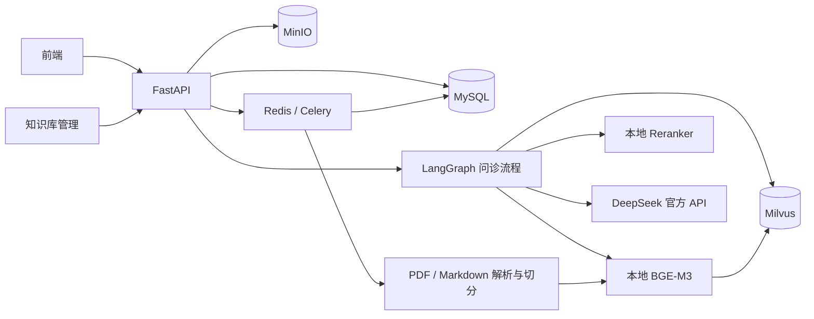
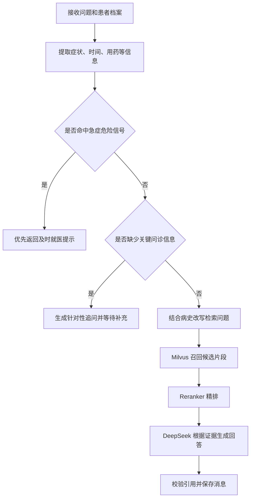

# 医疗智能问诊后端整体设计方案

> 2026-10-19 更新：本文为早期方案，包含尚未修订的 MySQL、Redis/Celery 等选型。当前使用 MongoDB，暂不引入 Redis 或鉴权；本次框架与开发约束以 [后端项目框架设计](后端项目框架设计.md) 为准。

## 1. 项目目标

构建一个面向实战项目的医疗知识辅助问答后端，支持患者信息维护、问诊会话、多轮补充、PDF/Markdown 指南入库、RAG 检索、回答引用和历史记录。

第一阶段目标链路：

> 上传 PDF/Markdown 指南 → 解析并建立索引 → 用户提问 → 检索证据 → Reranker 重排 → DeepSeek 生成带引用回答 → 保存会话和引用

系统定位为医学信息整理和指南检索辅助，不输出确诊结论。遇到明显急症危险信号时优先提示及时就医。

## 2. 已确定的技术选型

| 层次 | 技术 | 用途 |
|---|---|---|
| Web API | FastAPI + Pydantic | REST 接口、参数校验、SSE 流式响应 |
| 流程编排 | LangGraph | 多轮问诊状态、追问、检索和生成流程 |
| 模型组件 | LangChain | 文档处理、模型适配、检索器等通用组件 |
| 业务数据库 | MySQL | 用户、患者、会话、消息、文档和任务元数据 |
| 向量数据库 | Milvus | 医学知识片段向量和检索元数据 |
| 文件存储 | MinIO | 原始指南文件和后续上传资料 |
| Embedding | 本地 BGE-M3 | 文档和问题向量化，可利用 dense/sparse 表示 |
| Reranker | 本地 BGE Reranker | 对初步召回的候选片段精排 |
| 生成模型 | DeepSeek 官方 API | 信息抽取、追问判断、回答生成 |
| 后台任务 | Redis + Celery（建议） | PDF/Markdown 解析、批量向量化、重试 |

### 2.1 本地 Embedding 模型

当前模型目录为：

```text
D:\ai_models\modelscope_cache\models\bge-m3
```

已检查到该目录包含 BGE-M3 模型文件，`config.json` 的 `hidden_size` 为 **1024**。Milvus dense 向量字段应按 **1024 维**创建。BGE-M3 还支持 sparse 和 ColBERT 表示；第一版先使用 dense 向量检索，后续可评估 dense+sparse 混合检索。

启动时从配置读取模型目录，不要把路径散落在业务代码中。开发环境可使用绝对路径；部署环境通过环境变量或配置文件覆盖。

### 2.2 Reranker 选型

Reranker 与 Embedding 是两个不同模型。BGE-M3 负责快速召回，Reranker 对召回的少量候选重新打分和排序。建议单独准备支持中文的 `BAAI/bge-reranker-v2-m3`，并从本地目录离线加载。

如果暂时没有 Reranker 模型，先保留接口并用向量检索跑通链路；随后接入 Reranker，不需要改问诊接口或 Milvus 数据结构。Reranker 分数表示查询与片段的相关性，不能当成诊断置信度。

## 3. 系统架构



按职责划分为三个部分：

- **在线 API**：患者档案、会话、消息、文件上传、知识库管理。
- **问诊流程**：LangGraph 维护当前对话状态，执行信息抽取、追问判断、检索和回答。
- **离线入库任务**：解析文档、切分片段、生成向量、写入 Milvus，并更新任务状态。

第一版采用模块化单体即可。API 和后台任务可以是同一个代码仓库中的不同进程，不需要先拆微服务。

## 4. 文档入库设计

### 4.1 入库流程

1. 接收 PDF 或 Markdown 文件，检查扩展名、MIME 类型和文件大小。
2. 原文件上传 MinIO；MySQL 新建文档记录和 `pending` 入库任务。
3. 后台 Worker 下载文件并解析文本。
4. 按标题、章节、段落切分，保留页码或标题路径等来源信息。
5. 使用本地 BGE-M3 生成向量，批量写入 Milvus。
6. 全部成功后将文档状态更新为 `ready`；失败时记录错误并支持重试。

### 4.2 文件解析

- **PDF**：第一版使用 PyMuPDF 提取文字并保留页码，优先支持文字型 PDF。扫描版 OCR、复杂表格识别暂不纳入第一阶段。
- **Markdown**：按标题层级和段落解析，保存标题路径，例如 `第二章 > 临床表现 > 鉴别诊断`。
- 解析结果为空或文本过少时，将任务标记为失败并提示文件可能是扫描件。

### 4.3 切分策略

先按文档结构切分，再控制片段大小；不要只按固定字符数硬切。初始参数可以设为 **400～700 tokens**，相邻片段重叠 **80～120 tokens**，之后用检索评测集调整。

每个 chunk 建议包含：

```text
chunk_id
document_id
document_version
document_name
file_type
chapter_path
page_number
chunk_index
content_hash
text
```

PDF 的 `page_number` 必须对应原文页码；Markdown 可以为空。引用展示使用文档名、章节和页码定位原文。

### 4.4 文档更新与删除

- 对文件计算内容哈希，用于识别重复上传和版本变化。
- 新版本完成索引后再切换当前版本，避免新索引失败时旧版本不可用。
- 删除文档时，同时删除 MinIO 对象、MySQL 元数据和 Milvus 中对应版本的向量。
- Milvus 检索必须按启用状态、文档版本等元数据过滤，避免召回已删除或过期内容。

## 5. 在线问诊与 RAG 流程



### 5.1 检索与重排

1. 将用户问题和结构化病史整理成检索查询。
2. 本地 BGE-M3 生成查询向量，在 Milvus 召回约 **20～50** 个候选片段。
3. 对候选做元数据过滤，例如知识库、文档状态、版本和用户可见范围。
4. Reranker 对“问题 + 候选片段”逐条打分并排序。
5. 取前 **5～8** 个证据片段交给 DeepSeek。

第一版可以只做 dense 检索。BGE-M3 的 sparse 表示可以用于后续混合检索；如果当前 Milvus 版本或集成方式不合适，可先用 MySQL 全文索引补充关键词召回。混合召回后要合并去重，再统一交给 Reranker。

相似度阈值和 Reranker 分数需要通过项目自己的问题集校准，不应直接作为医学正确率或诊断置信度展示。

### 5.2 LangGraph 状态

图状态建议维护结构化信息，而非每轮都只依赖完整聊天记录：

```text
conversation_id
patient_context
symptoms
duration
severity
trigger_or_relief
medications
allergies
medical_history
missing_questions
retrieved_chunks
answer
citations
```

患者补充信息后，先更新状态，再判断是否需要继续追问或重新检索。MySQL 保存权威会话和消息记录；LangGraph checkpoint 可作为流程恢复能力，初期可用 MySQL checkpointer 或先用数据库消息重建状态。

### 5.3 回答结构与引用

要求模型按结构生成，例如：

```json
{
  "summary": "简要说明",
  "possible_explanations": ["可能性及不确定性"],
  "next_steps": ["建议的下一步"],
  "questions": ["需要补充的问题"],
  "red_flags": ["需要及时就医的信号"],
  "citations": ["chunk_id"]
}
```

后端只允许引用本轮实际提供给模型的 `chunk_id`，再将其映射为文档名、章节和页码返回前端。证据不足时应明确说明，不允许模型自行编造指南标题、出处或页码。

## 6. MySQL 数据模型

第一版建议包含以下表：

| 表 | 主要内容 |
|---|---|
| `users` | 登录账号、状态、创建时间 |
| `patients` | 患者基本资料、过敏史、既往史 |
| `conversations` | 患者、会话标题、状态、创建和更新时间 |
| `messages` | 角色、文本内容、结构化回答、发送时间 |
| `documents` | 文档名、版本、MinIO 对象键、哈希、入库状态 |
| `document_chunks` | chunk ID、文档版本、章节、页码、Milvus ID |
| `message_citations` | 消息 ID、chunk ID、引用顺序 |
| `ingestion_jobs` | 任务状态、进度、错误原因、重试次数 |

向量和大段原文放在 Milvus/MinIO；MySQL 保存业务数据和可查询的来源元数据。患者信息和会话数据都应有明确归属关系，接口查询时校验当前用户权限。

## 7. API 草案

```text
POST   /api/conversations
GET    /api/conversations
GET    /api/conversations/{conversation_id}
GET    /api/conversations/{conversation_id}/messages
POST   /api/conversations/{conversation_id}/messages   # 支持 SSE

GET    /api/patients/{patient_id}
PUT    /api/patients/{patient_id}

POST   /api/knowledge/documents
GET    /api/knowledge/documents
GET    /api/knowledge/jobs/{job_id}
DELETE /api/knowledge/documents/{document_id}
```

SSE 事件可以包括 `status`、`token`、`citation`、`done` 和 `error`。如果需要兼容断线重连，给事件附带可恢复的消息 ID。

## 8. 配置与运行方式

示例环境配置：

```env
MYSQL_DSN=...
MILVUS_URI=...
MINIO_ENDPOINT=...
MINIO_ACCESS_KEY=...
MINIO_SECRET_KEY=...
DEEPSEEK_API_KEY=...
DEEPSEEK_BASE_URL=https://api.deepseek.com
DEEPSEEK_MODEL=按账号可用模型配置
EMBEDDING_MODEL_PATH=D:\ai_models\modelscope_cache\models\bge-m3
RERANKER_MODEL_PATH=本地 reranker 模型目录
REDIS_URL=redis://localhost:6379/0
```

密钥只放在环境变量或本地未提交的密钥配置文件中，不写入前端、日志或 Git。开发时可以通过 Docker Compose 启动 MySQL、Milvus 依赖、MinIO 和 Redis；API 与 Worker 分别启动，便于观察任务和日志。

## 9. 代码模块建议

```text
app/
  api/              # FastAPI 路由
  core/             # 配置、日志、鉴权
  db/               # MySQL session、数据模型
  schemas/           # Pydantic 请求和响应
  services/          # 患者、会话、文档业务逻辑
  knowledge/         # 解析、切分、Embedding、Milvus、Reranker
  graph/             # LangGraph 状态、节点和流程
  llm/               # DeepSeek 客户端和提示模板
  workers/           # 文档入库任务
  storage/           # MinIO 客户端
```

业务接口不要直接混写 prompt、Milvus 查询和数据库操作；通过 service 和 graph 节点组织，便于单独调试和替换模型。

## 10. 分阶段实施与验收

### 阶段一：基础业务

- 完成 FastAPI 项目骨架、配置、数据库迁移和基础错误处理。
- 建立患者、会话、消息 API。
- 验收：创建患者和会话，消息可持久化并按时间查询。

### 阶段二：PDF/Markdown 知识入库

- 上传 MinIO，后台解析和切分。
- 用本地 BGE-M3 批量向量化并写入 Milvus。
- 验收：查看任务状态；能够根据 chunk 找回文件、章节和页码；失败任务可重试。

### 阶段三：检索与 Reranker

- 实现向量召回、元数据过滤、去重和 Reranker 排序。
- 准备一组代表性问题及人工标注的相关片段。
- 验收：对比重排前后的结果，确认相关证据通常排在前列；记录检索延迟。

### 阶段四：LangGraph 问诊与回答

- 实现病史抽取、缺失信息追问、检索、DeepSeek 回答和消息保存。
- 加入引用 ID 校验和危险信号提示。
- 验收：回答引用能定位原文；补充信息会更新上下文；证据不足时不会伪造来源。

### 阶段五：前端联调与健壮性

- 加入 SSE、文件状态展示、日志、权限检查和失败重试。
- 验收：前端可以完成上传、提问、逐步接收回答、查看引用和恢复历史会话。

## 11. 第一阶段范围与暂缓项

第一版包含 PDF/Markdown、文字型 PDF 解析、dense 检索、Reranker、DeepSeek 回答、引用和多轮会话。

暂缓扫描 PDF OCR、化验单结构化识别、语音、舌象、多租户知识库、复杂工作流和模型微调。等核心检索与引用链路稳定后，再按真实需求增加。

## 12. 风险与质量控制

- **模型回答可能错误**：回答需表达不确定性，提供证据来源，不包装成诊断结论。
- **检索到相关但不适用的指南**：保留适用人群、章节和版本信息，建立人工评测问题集。
- **引用和回答脱节**：引用只允许指向本轮候选证据，并在服务端校验。
- **患者数据敏感**：接口按用户和患者归属校验访问；日志避免记录不必要的病历全文；密钥不入库或入 Git。
- **模型服务不可用**：DeepSeek 超时、限流和异常要有明确错误处理；不要把错误伪装成医学回答。
- **入库重复或不完整**：使用文件哈希、任务状态和版本号，支持幂等重试。

